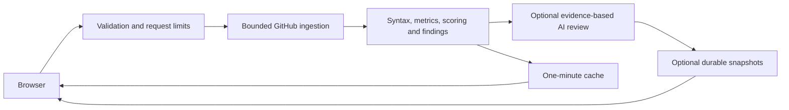
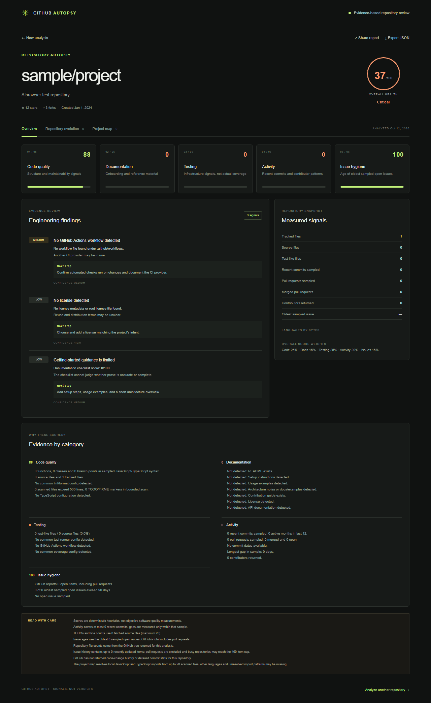

# GitHub Autopsy

A repository forensics application that turns observable GitHub signals into a transparent engineering health report. Scores are heuristics, not judgments of code quality.

## Run locally

Use Node.js 20.9 or newer. Copy .env.example to .env.local, configure PostgreSQL and run `npm run db:migrate`. Optionally add a GitHub token. Then run npm install and npm run dev, and open http://localhost:3000. Tokens are only read on the server. Development without a proxy uses one shared anonymous client identity.

For production, run `npm run build` followed by `npm start`. The build packages a standalone server and its static assets. Provide environment variables to the production process. Node.js 22 is recommended and required for the coverage command.

## What it measures

- Code signals: languages, tracked files, large files, TODO/FIXME markers, and lint/type/dependency configuration.
- Documentation: README, setup and usage guidance, architecture notes, contributing guide, license, and API docs.
- Testing: test/source file ratio, runner configuration, CI workflow presence, and coverage configuration.
- Activity: recent commits, pull-request and merge samples, contributors, and gaps within the sampled history.
- Issue hygiene: GitHub's open-item count and age of the oldest sampled open issues.
- Repository evolution: monthly commit activity, issue opens and closes, and lines added and removed.
- Project map: relationships between sampled JavaScript and TypeScript files, grouped by nearby folders.
- Syntax analysis: function, class, import, export and branch counts from parsed JavaScript/TypeScript.
- Contributor evolution: distinct identified GitHub accounts per month in sampled commits.
- Saved reports: optional immutable snapshots, stable share links and health/file-count comparisons.
- Optional AI explanation: up to three measured findings with actions, potential impact, confidence and caveats.

Scores show their evidence and rules. Overall weights and health thresholds are centralized in scoring.ts and can be adjusted there. Findings describe potential risks and include confidence and recommendations.

## Limits

Public repositories only. The analyzer samples up to 200 recent commits, fetches details for 12, and scans up to 20 source files (each at most 150 KB). JavaScript and TypeScript files are prioritized in that sample so the project map can resolve their local imports. The map supports static local import patterns and simple root tsconfig.json or jsconfig.json path aliases; dynamic or unresolved imports may be missed. Large Git trees may be truncated.

The issue timeline uses up to 400 recently updated issues from the last 12 months, excludes pull requests, and may omit older activity in very busy repositories. The code-change chart groups GitHub's weekly additions and deletions by month; if unavailable, it falls back to detailed stats for up to 12 recent commits. Net line changes are not the repository's exact source-code size. Commit gaps cover only the sampled commits. File ratios do not measure test quality or actual coverage. GitHub's open-item count includes pull requests.

Reports are cached for one minute in a bounded per-process cache of 50 entries. Expiry matters because metadata can change without a new commit. File reads and the tree use the sampled head revision. Private repositories are rejected even when the server token can access them.

Production requires `DATABASE_URL` for shared rate limits and immutable snapshots. Run `npm run db:migrate` before startup. PostgreSQL transactions serialize saves across instances, enforce 1,000 reports capped at 1 MB each and publish report/history together. Reads verify content hashes; indexed history retrieves at most 50 summaries. Storage failures leave analysis available with a caveat. `REPORT_STORAGE_DIR` is only a development adapter. See [operations](deploy/OPERATIONS.md) for backups, restoration and retention.

Set both `OPENAI_API_KEY` and `OPENAI_MODEL` to enable AI explanations with a model supporting Structured Outputs. Only scores, findings and caveats are submitted. Outputs must reference existing finding IDs. Provider failures, refusals or incomplete outputs leave the deterministic report available. The integration follows the [Responses API Structured Outputs format](https://developers.openai.com/api/docs/guides/structured-outputs?api-mode=responses). AI text can still be mistaken and does not replace measured evidence.

Rate limits and provider reservations use the shared PostgreSQL database across instances and fail closed when it is unavailable. The application ignores X-Forwarded-For: a private reverse proxy overwrites authenticated identity headers. Configure independent `TRUSTED_PROXY_SECRET` and `MONITORING_TOKEN` values (at least 32 URL-safe characters). GitHub reserves 50 requests per uncached analysis; AI permits 30 calls/hour with bounded evidence/output. Exhaustive historical ingestion, exact historical code size and other languages' syntax are outside this bounded implementation. Saved health trends begin with actual analyses.

## Architecture

The App Router API validates and orchestrates ingestion; github.ts makes bounded GitHub requests; analyze.ts computes metrics, scores and findings; evolution.ts builds history views; module-map.ts resolves sampled local imports; the client UI renders and exports the report as JSON. Next.js App Router, React, TypeScript and Tailwind CSS are used; charts are rendered with inline SVG and CSS.



## Verification

```sh
npm run test:qa
npm run test:production
npm run test:coverage
npm run build
npx playwright install chromium
npm run test:e2e
```

The 38 unit/integration tests cover validation, provider errors, disabled Issues, ingestion through the actual analyzer, scoring, cancellation, bounded downloads, syntax/import parsing, evolution, caching, persistence, monitoring authorization and AI contracts. Nine additional tests start real isolated PostgreSQL to exercise two application instances, spoofed headers, shared provider budgets, concurrency, killed writers, recovery and logical restores. Coverage includes both suites and measures executed transpiled server/analysis modules, excluding React rendering and unexecuted files.

The 12 Playwright cases run on desktop and mobile Chromium against the production standalone server. They cover rendering, empty/error states, tabs, share URLs, clipboard, downloads, saved comparisons and real API validation. The actual production API also runs ingestion, syntax analysis and report rendering against isolated GitHub fixtures. CI needs no credentials or API quota. GitHub Actions runs checks on pushes and pull requests and uploads failure traces.

## Screenshots

Browser-test examples using fixture data, not live repository measurements:



[Mobile report](docs/screenshots/report-mobile.png)

## Deployment

A non-root, multi-stage Dockerfile packages the standalone server and readiness healthcheck. Compose provisions PostgreSQL, the private app and an Nginx proxy. Copy .env.example to .env, set its secrets, then run `docker compose config --quiet` and `docker compose up --build --wait`. Add HTTPS at the hosting ingress. Do not publish application/database ports. Requests have a 55-second upstream budget, source streams are capped at 150 KB and JSON bodies at 8 KB. Read [operations](deploy/OPERATIONS.md) before deployment; CI contains a container build/start/proxy quota check and uploads deployment logs.

The production Next.js build and standalone browser flow are verified. Docker is unavailable here, so the image has not been run. Live AI execution requires credentials and a model. A hosted deployment and public demo are not claimed.
